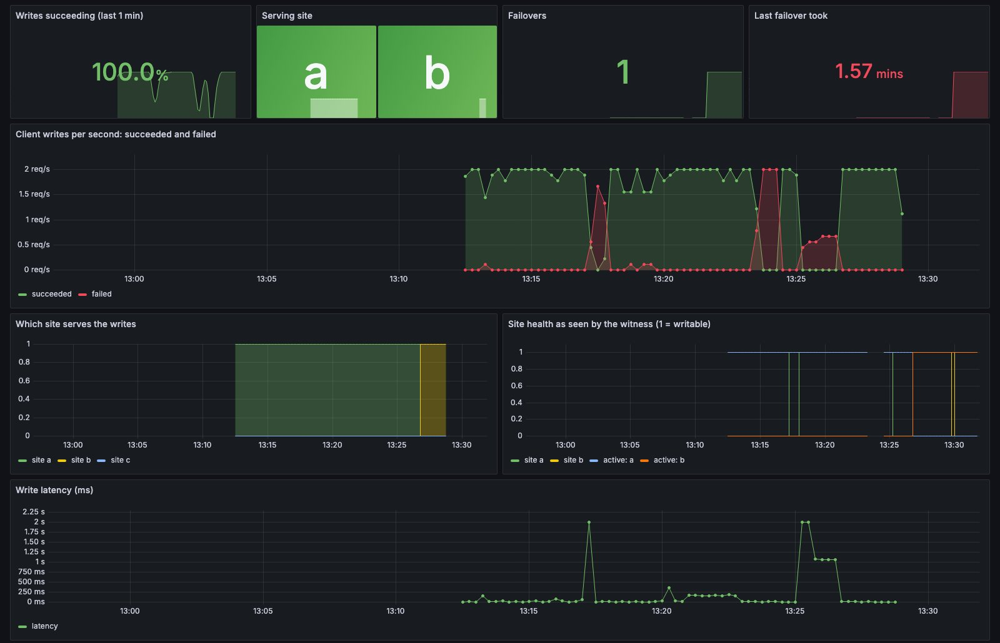

# ITI C2 Testbed: a three-site resilient infrastructure lab

A multi-site infrastructure lab shaped by the public description of National
Defence's **Information Technology Infrastructure in Support of Command and
Control (ITI in Sp of C2)** project: three sites on Proxmox, a K3s cluster at
two of them, replicated storage and databases, a witness that fails the
service over between sites without ever letting two sites write at once, and
every failure measured.

> Independent personal research by Taki Sadik. Not affiliated with, funded by,
> or submitted to DND or the CAF. Public information and my own hardware only.
> Project page: https://tyfsadik.org/work/defence/it-infrastructure-command-control

```
            site A (primary)              site B (standby)              site C (management)
          rtr-a  k3s-a1..a3             rtr-b  k3s-b1..b3              rtr-c  mgmt-c1
          C2 Board, DB primary x3  ──►  C2 Board, DB replica x2        witness + failover controller
          Longhorn, MetalLB             Longhorn, MetalLB              DNS c2.lab, S3 backups
                 │                             │                       Prometheus, Loki, Grafana
                 └──────── WireGuard mesh over an emulated WAN (VLAN 100) ──────┘
```

| Need | Here |
| --- | --- |
| Three sites | Proxmox VMs from Terraform (bpg/proxmox), one host or one physical host per site |
| Isolated, encrypted links | VLANs, nftables default deny, WireGuard full mesh, `wan-impair` for faults |
| Workloads | K3s with embedded etcd (3 servers per site), MetalLB |
| Replicated storage | Longhorn (3 replicas in a site), CloudNativePG replica cluster across sites |
| Backups | continuous WAL + hourly base backups, Longhorn and Velero backups, all to an S3 store at site C |
| Failover | witness + controller: write lease fencing, DNS switch, promotion, stale-site rule |
| Monitoring | Prometheus, Grafana Alloy, Loki, Grafana (availability dashboard) |
| Measurement | prober (an order every 0.5 s), chaos runners, report: RTO, availability, lost writes |

## Results (local rehearsal, run 4)

| Failure injected | Availability | RTO (s) | Longest outage (s) | Lost writes | Served by |
| --- | --- | --- | --- | --- | --- |
| baseline | 99.57% | - | 2.1 | 0 | a |
| app pod killed | 100% | 0 | 0 | 0 | a |
| database primary pod killed | 100% | 0 | 0 | 0 | a |
| node powered off (k3d-site-a-agent-0) | 74.26% | 30.1 | 29 | 0 | a |
| degraded WAN (80 ms, 2% loss) | 100% | 0 | 0 | 0 | a |
| witness (site C) lost for 60 s | 51.12% | 74 | 54.5 | 0 | a |
| site A lost (network cut) | 74.56% | 96.5 | 95.9 | 0 | a -> b |
| restore from S3 backup | - | 46 | - | - | 1210 orders restored |

The site failover took 94.2 s (90 s threshold + 4.2 s to promote and switch DNS). No acknowledged write was lost in any scenario.



Runs 1 to 3 found four bugs that would have lost data or caused needless failovers, and three flaws in the rehearsal itself; all are fixed and listed in [docs/04-testing.md](docs/04-testing.md), with every run's raw data in `results/`.

## Quick start

```bash
./local/rehearse.sh up && ./local/rehearse.sh test     # Docker + k3d, about 30 minutes
```

Proxmox build: [docs/01-physical.md](docs/01-physical.md) → [02-proxmox.md](docs/02-proxmox.md) →
[03-deploy.md](docs/03-deploy.md) → [04-testing.md](docs/04-testing.md).

## Docs

1. [Physical setup](docs/01-physical.md): one host, or one host per site with a managed switch
2. [Create the sites with Terraform](docs/02-proxmox.md)
3. [Configure everything with Ansible](docs/03-deploy.md)
4. [Break it and measure](docs/04-testing.md)
5. [Failing back](docs/05-failback.md)
6. [Local rehearsal](docs/06-rehearsal.md)
- [Architecture reference](docs/architecture.md)

## Repository map

```
terraform/        Proxmox VMs for three sites, generates the Ansible inventory
ansible/          routers, K3s, site C stack, cluster platform and workload
k8s/              databases (primary, replica, restore), app, MetalLB, Longhorn, Velero, Alloy
services/         C2 Board app, failover controller (witness), prober; one image
stacks/mgmt/      site C: CoreDNS, S3 (SeaweedFS), Prometheus, Loki, Grafana, controller, prober
local/            the Docker rehearsal
chaos/            failure scenarios on the Proxmox build
tools/            report (RTO, availability, lost writes), manifest renderer, secrets
tests/            unit tests
results/          rehearsal reports
```

## Status

- Rehearsed for real in Docker (k3d, CloudNativePG 1.24, the full site C stack).
- Offline checks: unit tests, `terraform validate`, `ansible-playbook --syntax-check`,
  every manifest and pinned Helm chart validated against the Kubernetes schemas,
  the Alloy config parsed by Alloy, ShellCheck.
- Not yet run: the Proxmox build (Longhorn, MetalLB, WireGuard, Velero on real VMs).

MIT licence.
